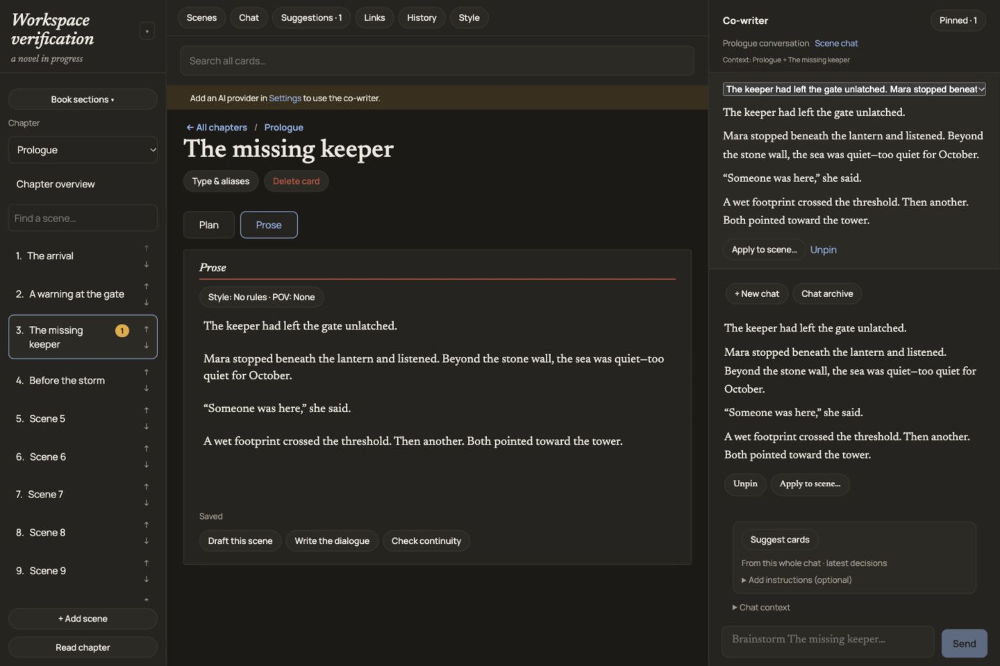

# Reefnote

A self-hosted writing room for novels. Organize your premise, outline, characters, arcs, worldbuilding, plots, chapters, scenes, and beats as linked cards, write prose in a focused editor, and (optionally) bring your own AI model as a co-writer.

The co-writer only **proposes** changes. Every suggestion is reviewed, and can be edited, before it touches your manuscript. Your writing stays under your control and on your machine.



## Features

- **Story cards.** Premise, outline, characters, character arcs, world and rules, grand plot and subplots, and chapters, all cross-linked with aliases and "appears in" tracking.
- **Chapter, scene, and beat workspace.** Plan and Prose tabs per scene, reordering, scene splitting, a reader view, and full edit history with restore.
- **Plot-first development.** [Subplot mode](docs/subplot-mode.md) lets you develop a plot from premise to turning points to scenes, with rolling summaries, card extraction proposals, ripple checks, and atomic rollback.
- **Voice and style.** A protected book voice for every novel, scene presets, character dialogue and interior voices, and a built-in [style library](src/lib/style-library/) you can extend, import, and export.
- **Optional AI co-writer.** Brainstorming, scene and dialogue drafting, continuity checks, and chat scoped to any card. A two-pass writing and structuring flow with a reviewable diff. Every response logs the exact context it was sent.
- **Bring your own provider.** OpenAI, Anthropic, Google, OpenRouter, or a local [Ollama](https://ollama.com) model. Any OpenAI-compatible endpoint works through a custom base URL. API keys are encrypted at rest.
- **Export.** EPUB (with table of contents), PDF (with title page and page numbers), or Markdown. Planning notes and suggestions are excluded.
- **Local first.** One Node process and one SQLite file. No account, no cloud database, no telemetry.

## Quick start

Requires **Node.js 20.19+** (22 or 24 recommended).

```sh
git clone <this-repo-url> reefnote
cd reefnote
npm install
npm run build
npm start
```

Open http://127.0.0.1:4317, create a novel, and start writing. AI is optional. To enable the co-writer, open **Settings**, choose a provider, paste your API key, pick a writing model and a structuring model, then click **Test connection**.

For development with hot reload:

```sh
npm run dev
```

## Configuration

All settings are environment variables. None are required for local use.

| Variable | Default | Purpose |
| --- | --- | --- |
| `HOST` | `127.0.0.1` | Interface to bind. |
| `PORT` | `4317` | Port to listen on. |
| `NOVEL_STUDIO_PASSWORD` | unset | Enables a sign-in page. **Required** when `HOST` is not a loopback address; the server refuses to start without it. |
| `ORIGIN` | `http://HOST:PORT` for loopback | Public origin when behind a reverse proxy. Use HTTPS for any remote access. |
| `NOVEL_STUDIO_DB` | `data/novel.db` | SQLite database path. |
| `DATA_DIR` | `data/` | Directory for `secret.key`. |
| `BODY_SIZE_LIMIT` | `20M` | Maximum request body, sized for very long scenes. |

### Your data

- `data/novel.db` holds all of your writing. It is created on first run.
- `data/secret.key` is a randomly generated AES-256-GCM key (file mode `600`) that encrypts stored provider API keys. **Back it up alongside the database.** Encrypted credentials can't be recovered without it.
- `data/style-library/` holds your edits to built-in style entries and any custom ones.

The whole `data/` directory is gitignored. For a consistent backup, stop the app and copy `data/`.

## Remote access (optional)

Reefnote binds to localhost by default. To reach it from another device, put it behind something that provides authentication and TLS, and always set `NOVEL_STUDIO_PASSWORD`.

The repo includes a helper for private access over [Tailscale](https://tailscale.com) on macOS:

```sh
cp config/tailscale.example.json config/tailscale.json   # optional: pin your tailnet hostname
npm run remote
```

`npm run remote` checks that Tailscale is connected, builds the app, enables **private** Tailscale Serve HTTPS forwarding (not public Funnel), sets `ORIGIN`, and keeps the Mac from idle-sleeping while the server runs. The app itself stays bound to `127.0.0.1`, and access is governed by your tailnet's ACLs. To remove the forwarding later, run `tailscale serve --https=443 off`.

`config/tailscale.json` is gitignored because it contains your machine's tailnet hostname.

## Security model

- Loopback-only by default. Binding to any other interface requires a password.
- Password sessions use HMAC-signed, `HttpOnly`, `SameSite=Strict` cookies (`Secure` over HTTPS), with a 7-day lifetime and login rate limiting.
- State-changing requests with a foreign `Origin` header are rejected.
- Provider API keys are encrypted with AES-256-GCM and never returned to the browser.
- Style library imports reject path traversal, oversized entries and archives, and silent overwrites.

Please report vulnerabilities privately to the maintainer rather than in a public issue.

## Development

```sh
npm run check   # svelte-check and TypeScript
npm test        # Vitest suite (AI providers are mocked; no API charges)
npm run build   # production build
```

Browser smoke tests live in `scripts/smoke-*.mjs`. They expect a **disposable** server (default `http://127.0.0.1:4318`), use Playwright with an installed Chrome, and create and delete their own fixture novels. Don't point them at your real library.

### Project layout

```
src/
  routes/              SvelteKit pages and the /api catch-all
  lib/components/      Studio UI (editor, markdown fields, style controls, subplots)
  lib/server/
    db/                SQLite schema and migrations
    ai/                providers, prompts, context assembly, two-pass flows
    subplots/          plot-first generation, indexing, review, rollback
    style/             style library and resolution
    security/          password sessions
  lib/style-library/   built-in voice, character, and scene presets (Markdown)
scripts/               start, remote, and browser smoke tests
tests/                 Vitest suites and fixtures
SPEC.md                product specification (source of truth)
tasks/                 workstream notes from the initial build
```

Built with [SvelteKit](https://svelte.dev) on the Node adapter, [better-sqlite3](https://github.com/WiseLibs/better-sqlite3), and [CodeMirror 6](https://codemirror.net).

## Known limitations

- Deleting a card permanently removes its descendants. History restores edits to cards that still exist.
- Live model output quality isn't covered by automated tests, which use mocked providers.
- Chapterless subplot elements are excluded from manuscript exports until chapter assembly lands.

## Contributing

Issues and pull requests are welcome. Run `npm run check` and `npm test` before opening a PR, and never commit anything from `data/`.

## License

Reefnote is released under the [MIT License](LICENSE). You're free to use, modify, and redistribute it, including commercially, as long as you keep the copyright and license notice. If you build on Reefnote, a credit and a link back to this project is appreciated.
